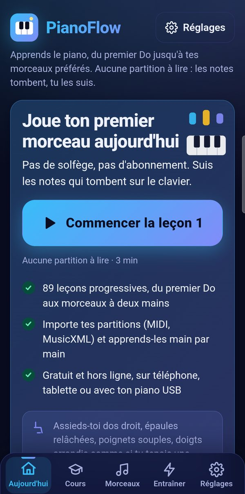
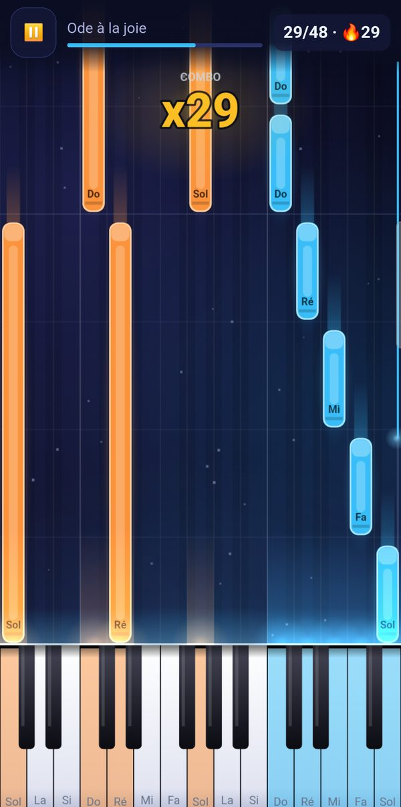
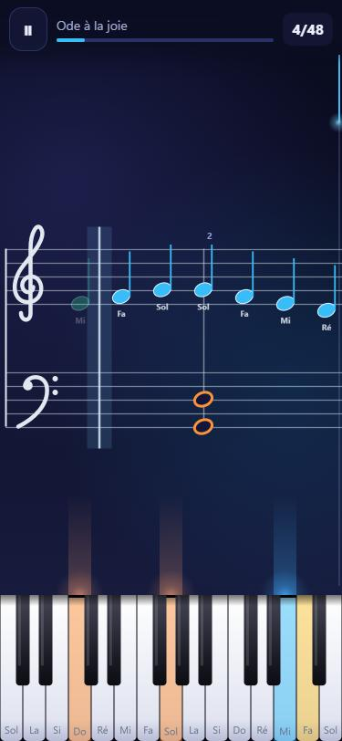
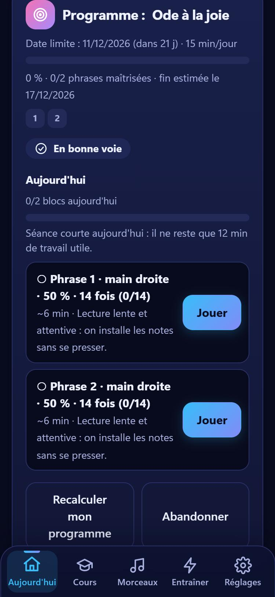
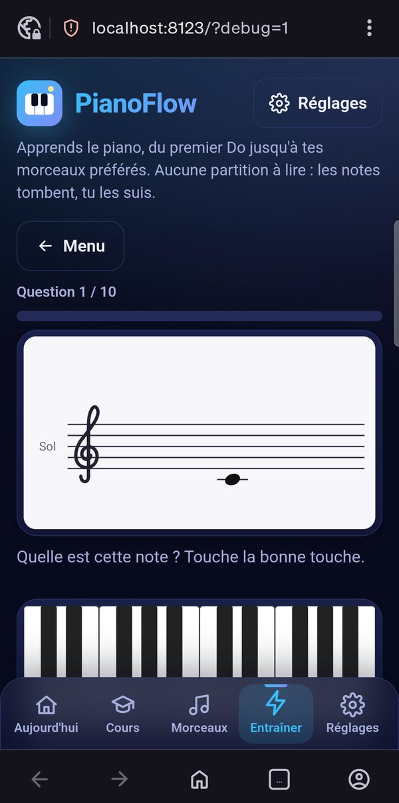

# PianoFlow 🎹

[](https://github.com/AntoineBREVARD/PianoFlow/actions/workflows/apk.yml)


**Apprendre le piano sans savoir lire une partition, puis apprendre à la lire.** PianoFlow est une application (web hors ligne + APK Android) qui guide un débutant du premier *Do* jusqu'à ses morceaux préférés, avec un parcours qui **s'adapte à son niveau réel mesuré**.

<p align="center">
  
  
  
  
  
</p>

> **English summary** — PianoFlow is a piano-learning app (offline PWA + Android APK) written in vanilla JavaScript with no framework and no build step. Beginners play along falling notes or a scrolling staff, with real-microphone and MIDI input. It includes an adaptive learning planner (skill model + deadline-based practice schedule), spaced repetition, ear training, sight-reading exercises, MusicXML/MIDI import, and a CI pipeline that tests the code and builds a signed debug APK.

## Ce que fait l'application

- **Deux façons de jouer, au choix** : *touches qui tombent* (style Piano Tiles / Synthesia, très accessible) ou *partition qui défile* (vraie portée en clés de Sol et de Fa, style Simply Piano). La même logique de jeu sert aux deux vues.
- **89 leçons en 10 niveaux** : repères sur le clavier, rythme, deux mains, lecture de la musique, harmonie, technique, premiers classiques, avec un test de placement au départ. 24 morceaux et exercices (airs populaires ou du domaine public).
- **Programme personnalisé pour apprendre un morceau avant une date** : l'appli mesure le niveau du joueur, découpe le morceau en phrases, estime le temps nécessaire, annonce honnêtement si l'objectif est réaliste, puis **recalcule le planning** selon la progression réelle (elle ne passe jamais à la suite tant qu'une phrase n'est pas maîtrisée, et accélère si le joueur est en avance).
- **Apprentissage actif** : lecture de notes sur portée (8 paliers), accords en lettres (22 accords, à retenir par cœur), entraînement de l'oreille (5 paliers), révision espacée.
- **Entrées multiples** : écran tactile, **micro (vrai piano acoustique)**, piano **USB-MIDI** (version web).
- **Import MusicXML / MIDI**, enregistrement de sa partie, partage de sa progression, rappels quotidiens (notifications Android).
- **Motivation sans pression** : XP, niveaux, badges, séries de jours, objectifs de la semaine.

## Ce qui est techniquement intéressant

| Sujet | Où | Idée |
|---|---|---|
| **Modèle de niveau du joueur** | [`skill.js`](skill.js) | 11 dimensions (hauteur, rythme, timing, main gauche/droite, coordination, sauts, accords, tempo, endurance, hésitation), estimation bayésienne type Elo avec incertitude, oubli dans le temps et tendance. Chaque tentative met à jour le profil. |
| **Analyse de morceau et planificateur adaptatif** | [`songplan.js`](songplan.js), [`goals.js`](goals.js) | Difficulté par phrase, étapes (main par main, deux mains, 60/80/100 % du tempo), blocs de travail bornés, révisions espacées, verdict de faisabilité, replanification quotidienne. |
| **Détection de notes au micro** | [`mic.js`](mic.js) | FFT de 16 384 points ; on ne demande pas « quelle note ? » mais « les notes attendues sonnent-elles ? » (gabarit d'harmoniques pondéré, détection d'attaque par flux spectral, plancher de bruit calibré). |
| **Moteur de jeu temps réel** | [`app.js`](app.js), [`score.js`](score.js) | Canvas 2D, rendu du seul contenu visible, objets recyclés (pas d'allocation par image), ~0,5 ms de calcul par image ; mesuré à 60 images/s sur un Galaxy S21 Ultra. |
| **Synthèse sonore** | [`synth.js`](synth.js) | Piano synthétisé avec Web Audio (pas d'échantillons à télécharger, donc hors ligne). |
| **Import de partitions** | [`parsers.js`](parsers.js) | MusicXML compressé et MIDI, avec validation et garde-fous (taille d'archive, tempos aberrants). |
| **Répétition espacée** | [`chords.js`](chords.js), [`reading.js`](reading.js), [`ear.js`](ear.js) | Boîtes de Leitner (1, 3, 7, 14, 30 jours). |
| **Sécurité des données importées** | [`stats.js`](stats.js) | Validation stricte des sauvegardes importées, échappement systématique du HTML, plafonds de taille. |

L'application n'a **aucune dépendance d'exécution** : pas de framework, pas de CDN, pas d'étape de compilation. Le détail est dans [`docs/ARCHITECTURE.md`](docs/ARCHITECTURE.md).

## Qualité et intégration continue

- **15 fichiers de tests** ([`run-tests.mjs`](run-tests.mjs)), sans bibliothèque : analyse de morceaux, modèle de niveau, planificateur (cohérence sur tous les morceaux et plusieurs durées), parseurs, partage, bouton Retour, rendu partition…
- **GitHub Actions** ([`apk.yml`](.github/workflows/apk.yml)) : à chaque changement, tests → vérification de la cohérence du cache hors ligne → génération du projet Android (Capacitor) → compilation → **vérification que l'APK est signé avec la clé attendue** → publication de l'artefact.
- **Testé sur un vrai téléphone** : installation de l'APK, jeu à 60 images/s, micro avec un son de piano joué par un PC, notifications et feuille de partage Android. Ces essais ont révélé et corrigé de vrais défauts (par exemple des fausses notes comptées à tort avec le micro, un partage qui ne faisait rien dans l'APK).

## Essayer

**APK Android** : onglet *Actions* → workflow « Build PianoFlow APK » → dernier run vert → artefact `PianoFlow-apk` (zip contenant `app-debug.apk`). Il s'installe par-dessus la version précédente. C'est un APK de debug (autorise les « sources inconnues »).

**En local (navigateur)** :
```bash
python3 -m http.server 8123
# puis http://localhost:8123
```
Le micro et l'installation en application web demandent du HTTPS (ou `localhost`).

**Tests** :
```bash
node run-tests.mjs
```

## Limites connues

- Le micro est **monophonique** : fiable pour une note à la fois, pas pour les accords. Mes essais ont utilisé un son de piano synthétique ; il reste à valider avec un piano acoustique.
- Les formules du modèle de niveau et du planificateur sont des **heuristiques**, validées seulement par simulation de joueurs et par tests de cohérence, **pas sur de vrais élèves**.
- La vue partition est volontairement simple : pas de silences, d'armure ni de barres de croches.
- Le MIDI USB n'est pas disponible dans l'APK (limite de la WebView Android) ; il fonctionne dans la version web.
- Quelques mélodies, écrites de mémoire, restent à vérifier à l'oreille.

## Méthode de travail

Projet développé avec l'aide d'un assistant IA (Claude Code, d'Anthropic) : le code, les tests et la documentation ont été produits en collaboration, avec essais sur appareil réel et corrections itératives. Historique complet des changements dans les *pull requests* du dépôt.

## Feuille de route

Voir [`docs/ROADMAP.md`](docs/ROADMAP.md). Documents annexes : [fiche de publication](docs/STORE.md), [politique de confidentialité](docs/PRIVACY.md).

## Licence

[MIT](LICENSE). Les morceaux fournis sont issus du domaine public ou de la tradition populaire. Partitions libres pour aller plus loin : [MuseScore](https://musescore.org), [Mutopia](https://www.mutopiaproject.org), [IMSLP](https://imslp.org).
