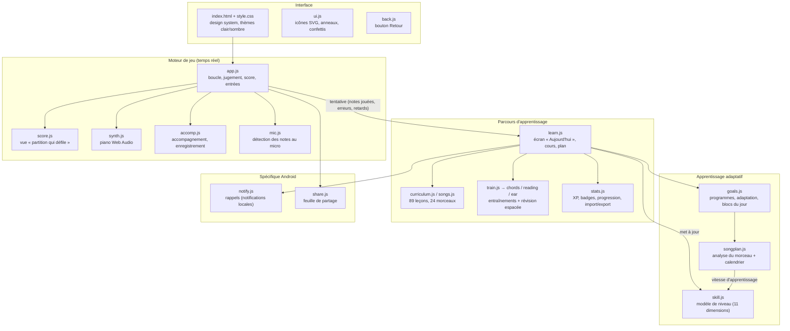

# Architecture de PianoFlow

PianoFlow est une application **JavaScript sans framework ni étape de compilation** : des modules ES chargés directement par le navigateur. Le même code sert la version web (installable, hors ligne) et l'APK Android (emballé avec Capacitor).

## Vue d'ensemble



## Principes de conception

- **Une seule logique de jeu, plusieurs façons de la dessiner.** Le jugement des notes, le score et le contrat de sortie (`onDone` avec une *tentative* détaillée) ne dépendent pas de la vue ; `draw()` choisit entre les touches qui tombent et la partition.
- **La tentative est la donnée centrale.** Chaque partie produit `{morceau, mains, vitesse, notes: [{note, mesure, doigt, réussie, écart de temps…}], erreurs}`. C'est ce qui alimente le modèle de niveau, le planificateur et l'écran « Ce qui a coincé ».
- **Parties pures testables sans navigateur.** Les calculs (modèle de niveau, analyse de morceau, planification, conversion note → position sur la portée, validation d'import…) sont isolés des fonctions qui touchent au DOM, et testés avec `node` seul.
- **Hors ligne d'abord.** Aucune ressource externe ; un *service worker* met en cache la liste exacte des fichiers (vérifiée en CI) ; le son est synthétisé plutôt que téléchargé.
- **Données locales.** Tout est stocké dans `localStorage` (clés `sp.*`), jamais envoyé sur un serveur. Les imports de sauvegarde sont validés strictement.

## Le modèle de niveau (`skill.js`)

Chaque dimension (hauteur, rythme, timing, main gauche, main droite, coordination, sauts, accords, tempo, endurance, hésitation) est une estimation `μ` avec une incertitude `v`, mise à jour après chaque tentative selon la difficulté de ce qui a été joué (principe proche du classement Elo, mais avec variance). Les estimations **s'oublient avec le temps** et une tendance est calculée. Le planificateur s'en sert pour estimer le temps de travail réaliste de chaque phrase d'un morceau.

## Le planificateur (`songplan.js`, `goals.js`)

1. **Analyse** : découpe en phrases (2 à 8 mesures, coupées en demi-phrases si trop longues), difficulté de chaque phrase, temps estimé.
2. **Calendrier** : chaque phrase traverse des étapes (main droite, main gauche, deux mains, 60 %, 80 %, 100 % du tempo), puis des révisions espacées, un raccord entre phrases et un passage complet la veille de l'échéance. Le travail du jour est regroupé en blocs bornés.
3. **Adaptation** : après chaque tentative et chaque jour, comparaison entre progression attendue et réelle ; le calendrier est recalculé. En retard, l'étape est rallongée (on ne passe jamais à la suite sans maîtrise, c'est-à-dire ≥ 85 % de réussite à la vitesse cible sur deux tentatives consécutives) ; en avance, la date de fin estimée recule.
4. **Verdict de faisabilité** honnête : réaliste, serré ou irréaliste, avec des suggestions (plus de minutes par jour, date plus tardive, ne garder que le début).

## Détection au micro (`mic.js`)

Plutôt que d'identifier la note jouée (fragile avec les harmoniques), on teste si **les notes attendues** sont présentes dans le spectre : niveau de la fondamentale et des harmoniques 2 et 3, pénalité des sous-harmoniques, rejet de l'harmonique d'une note une octave plus bas, seuil relatif à un plancher de bruit calibré. Un appui n'est créé qu'après une **attaque** détectée (variation spectrale). Cette approche permet en principe de gérer plusieurs notes simultanées ; la fiabilité sur des accords n'est pas validée.

## Chaîne de build (GitHub Actions)

```
tests (node) → vérification des fichiers du cache hors ligne → npm install
→ génération du projet Android (Capacitor) + permissions
→ signature de debug fixe (signing/debug.keystore)
→ compilation Gradle (3 tentatives)
→ vérification de l'empreinte du certificat de l'APK
→ publication de l'artefact
```

La clé de debug est volontairement publique : elle ne sert qu'à ce que chaque APK de test s'installe par-dessus le précédent. Une publication sur le Play Store demanderait une clé privée distincte.

## Ce qui n'est pas (encore) fait

Voir [`ROADMAP.md`](ROADMAP.md) et la section « Limites connues » du [README](../README.md).
